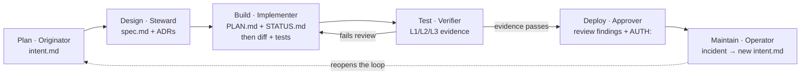
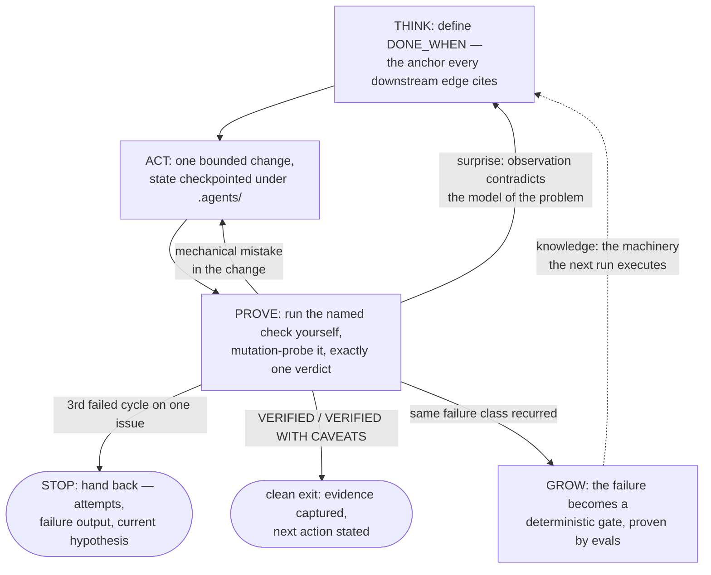

[](https://github.com/bouroo/agents)

[](./LICENSE.md)

# bouroo/agents

A shared setup for autonomous coding agents that is **agnostic of programming languages, agent frameworks, and agent harnesses**: one governance manifesto, ten on-demand skills, four routine-task command workflows, and two role agents (lead, worker). Any coding agent that reads repository instruction files can consume it as-is — no installer, no manifests, no per-tool copies.

## The foundation: the AI-native delivery loop

The doctrine's spine is the **AI-native SDLC** — six stages that run as a loop, not a phase sequence. Code stopped being the bottleneck once agents could write it faster than humans could plan, review, and ship around it, so the constraint moved outward — to plan, review, and governance. Every stage commits a readable artifact the next begins from, and that chain of commits is the audit trail.



`Test → Build` is the canonical review back-edge; `Maintain → Plan` reopens the loop. Seven **seats** own the stages — one agent may hold several at once, but the Implementer never approves its own work and the Verifier is always independent of what it judges. Within a stage, work is shaped by the **execution graph** (below): the lifecycle says *which stage and what it commits*; the graph says *how that work runs*.

Four rules carry the loop, and they are what turn a set of phases into a process that survives agents:

- **The accepted artifact fires the next gate.** A committed `intent.md` triggers the design pass; an approved `spec.md` triggers planning; a merged change triggers the pipeline. The handoff is the commit, so a person holds the gate rather than the handoff.
- **One source of truth per artifact.** Where a legacy system already holds the record, name it the source of truth and keep the committed artifact as a linked working copy. Two copies with no link are two truths.
- **Advisory controls make violations rare; deterministic controls make them close to impossible.** A skill shapes the work while it is written; a policy that must always hold needs a hook or a check behind it.
- **Autonomy stops at the gate.** The agent acts up to the production gate and nothing past it, tiered per environment, so the human gate sits above the automation rather than inside it.

The `delivery` skill carries the plays for each stage — the steps, the governance, and the leading and lagging indicators that say whether each one worked.

## What's inside

```
├── AGENTS.md                          the manifesto: intake route, decision gates,
│                                      the six-stage delivery loop, the execution
│                                      graph, verification dial, context/state,
│                                      constraints
├── skills/
│   ├── delivery/                      the spine: six stages and their exit checks,
│   │                                  the plays, controls, and automation tiers;
│   │                                  the artifact shapes, plan-first grilling,
│   │                                  the wayfinder decision map
│   │   └── references/                plays: per-stage steps, governance, and
│   │                                  measurement; artifact shapes; grilling;
│   │                                  wayfinder; common mistakes
│   ├── execution/                     the execution-graph grammar: nodes, typed edges,
│   │   └── references/                caps, anchors, shapes, cost; worked topologies;
│   │                                  harness design: minimal-harness ladder, ACI,
│   │                                  memory layers, external-system context,
│   │                                  the execution environment, automation,
│   │                                  runtime state (recording, attribution,
│   │                                  recovery)
│   ├── quality/                       craftsmanship, verification, evals, and
│   │   └── references/                performance: the twelve commandments, evidence as
│   │                                  anchors, the regression suite, measure-first;
│   │                                  flowcharts, evolution, measurement, tactics
│   ├── architecture/                  ASRs + SEI scenarios, pattern selection by
│   │   └── references/                tradeoff, ADRs, C4 modeling, domain language,
│   │                                  GoF patterns, interactive system maps
│   ├── confluence/                    operate Atlassian wikis via Rovo or
│   │                                  mcp-atlassian MCP servers
│   ├── modernize-coding/              bring a project's code to current patterns
│   │   └── references/                per-language adapters: go, java, rust,
│   │                                  python, typescript
│   ├── indexed-search/                large-tree search: probe tgrep, index/serve
│   │                                  lifecycle, fallback ladder rg -> Grep
│   ├── problem-details/               RFC 9457 error responses: five-member
│   │   └── references/                application/problem+json contract, extension
│   │                                  members, greenfield + retrofit adoption;
│   │                                  schema, stack snippets, contract test
│   ├── security-audit/                the candidate gate, calibrated severity,
│   │   └── references/                needs_validation discipline; attack-class
│   │                                  coverage and per-domain hunter rules
│   └── unslop/                        remove AI residue from prose, code, and UI:
│       └── references/                rule lists per surface, stable rule ids;
│                                      scanner script; prose (MIT) and UI (CC BY) credits
├── agents/                           role agents: lead + worker
│   ├── lead.md, worker.md            root links, for omp's plugin-level scan
│   ├── common/                       md + plain.md variants of both
│   └── codex/                        codex toml variants
├── commands/
│   ├── cmd-verify.md                  Test: quality-gate pipeline with fix/re-verify
│   ├── cmd-review.md                  Test: severity-grouped review with one verdict
│   ├── cmd-refactor.md                Build: behavior-preserving restructure, measured
│   └── cmd-document.md                Spec: bootstrap/sync a docs/ tree
├── evals/                            the harness regression suite (CI-gated):
│   ├── suite.json                    one realistic task per eval, objective checks
│   ├── trigger.json                  labelled prompt set that measures descriptions
│   ├── run_suite.py                  suite runner: executes the checks, reports the
│   │                                pass rate, exits non-zero when a check is red
│   └── run_triggers.py               trigger-rate runner (train/validation split)
├── .claude-plugin/, .cursor-plugin/   marketplace plugin + listing metadata
├── .minimax-plugin/                   MiniMax Code plugin metadata
├── gemini-extension.json              extension discovery metadata
├── standalone/
│   ├── AGENTS.md                      the compact single-file doctrine (install --standalone)
│   └── SOUL.md                        per-host variant for hosts whose instruction file is SOUL.md
└── scripts/
    ├── check.py                       twenty-seven deterministic gates (CI runs these)
    └── install.sh                     detect tools on a machine and install
```

## The execution graph

Inside a lifecycle stage, every job runs as an **execution graph**: THINK → ACT → PROVE → GROW are the role-nodes most jobs need, edges are typed and conditional, and every cycle is capped — the forbidden shape is a node re-entering itself with no new evidence. Three graph structures organize anything above trivial: the **task graph** (what: units, dependencies, DONE_WHEN), the **coordination graph** (who: solo → delegation → team), and the **state graph** (how it operates: the repository as system of record). Every proof chain terminates in an **anchor** — a fixed external node like a spec clause, the user's words, or captured command output that the machinery may read but never rewrite; the authority rank (user statement > spec > checks > code) is the anchor ordering. The grammar lives in [graph-engineering](./skills/execution/SKILL.md); entering at the least agency that closes on evidence — a prompt before a workflow, a workflow before an agent loop — is the [minimal-harness ladder](./skills/execution/references/harness-design.md).

The loop as a chart — the role-nodes, the surprise back-edges, the hard cap, and GROW's knowledge edge back into the machinery:



The full decision charts — the intake router, each node's internal loop, and the judge protocol — render in [quality/references/flowcharts.md](./skills/quality/references/flowcharts.md).

## The doctrine in one line

Pin the ask in concise English, then classify before working (trivial / fit / shape); owe named gates at decision points (`PROMPT:` `INTENT:` `TWINS:` `AUTH:` `PENDING:`); run every job through the six-stage delivery loop, sized to the job — the compact path (one THINK, one ACT, one PROVE, no artifact chain) is the default for a small, local, reversible change, and the six-stage path is owed when the work is large, irreversible, outward-facing, cross-session, or multi-agent; shape each stage's work as an execution graph with typed edges and capped cycles; terminate every proof chain in an anchor; prove with layered evidence (L1 static / L2 runtime / L3 end-to-end), a mutation probe on high-risk work, and a hard verify bound of 3 failed cycles; pass large or hard-to-re-derive deliverables through Generate-Verify-Refine-Deliver — an adversarial Verifier persona re-derives the pinned constraints point-by-point, and a Verification Report (Requirement Check / Logic Audit / Final Verdict) precedes the deliverable — while every other deliverable is verified in place; grow by governed evolution — recurring failures become deterministic gates, the eval suite proves an evolution helped, and controls better models make redundant are cut.

## Using it

Manual consumption only:

- **Manifesto** — copy `AGENTS.md` content into your assistant's instruction file at whatever location your tool reads, or point the tool at this file directly.
- **Skills** — copy or symlink individual `skills/<name>/` directories into the skill path your runtime discovers (they carry standard Agent-Skills frontmatter: `name` + `description`).
- **Commands** — `commands/<name>.md` are self-contained routine-task workflows (verify / review / refactor / document); paste their arguments after invocation wherever your tool surfaces custom prompts, or load them on demand.
- **Role agents** — [agents/common/](./agents/common/) ships two ready-made role agents for the teamwork doctrine: **lead** (decomposes a complex task into units, dispatches each to a subagent with an executable DONE check, verifies every returned unit itself, owns the merge — never implements a unit), and **worker**, which executes exactly one unit and returns files changed plus evidence. Three ways to activate them:

  - **Installer (recommended)** — `./scripts/install.sh install` places the right variant in each host's agent directory automatically: hosts that accept a `name:` frontmatter key (Claude Code, Gemini CLI, Qwen, pi, omp) get [lead.md](./agents/common/lead.md) and [worker.md](./agents/common/worker.md); hosts that derive the id from the filename (opencode, kilo) get the `.plain.md` no-name variants (lead as `mode: primary`, worker as `mode: subagent`); Codex gets the TOML variants copied into `~/.codex/agents/`. Confirm with `./scripts/install.sh status` — `agents=ok` means both are in place. Hosts without an agents surface (openclaw, hermes, MiniMax) install the manifesto and skills only.
  - **Claude Code plugin** — the marketplace metadata lists both agents, so `/plugin marketplace add bouroo/agents` then `/plugin install coder-agents@bouroo-agents` makes them dispatchable by name.
  - **Manual** — copy or symlink [agents/common/lead.md](./agents/common/lead.md) (or its `.plain.md` variant where the host rejects a `name:` key) into the agent directory your runtime scans.

  Once active, invoke the lead agent by name through your host's subagent dispatch — a Task/agent tool call, an @mention, or a spawn by name — and it routes implementation units to `worker` when present, else to the host's general-purpose agent.
- **Marketplaces** — the repository ships plugin/extension discovery metadata at its canonical paths (`.claude-plugin/`, `.cursor-plugin/`, `.minimax-plugin/`, `gemini-extension.json`), so Agent-Skills-compatible CLIs can add it directly from GitHub (`npx skills add bouroo/agents`) and host marketplaces consume it without any generation step. omp consumes the same marketplace through its Claude Code-compatible fallback (`/marketplace add bouroo/agents`); its plugin loader takes skills from the manifest path lists and role agents from the repo-root `agents/` directory. MiniMax Code additionally accepts the repository directly as a plugin from a public GitHub repo, since its plugin root is the repository root.
- **Local installer** — `scripts/install.sh` detects which compatible tools live on the machine and links (or copies) the setup into each one's config directory:

  ```bash
  ./scripts/install.sh detect               # what did we find?
  ./scripts/install.sh install              # all detected tools
  ./scripts/install.sh install --dry-run    # preview the exact actions
  ./scripts/install.sh status               # per-tool link state
  ./scripts/install.sh uninstall            # removes only links pointing into this repo
  ./scripts/install.sh install --standalone # compact single-file doctrine only
  ```


If a previous major version installed symlinks on your machine, remove them with that version's uninstaller from git history — v4 ships nothing that writes outside this repository.

## Verification

```bash
python3 scripts/check.py --all
```

| Gate | Enforces |
| --- | --- |
| `budget` | `AGENTS.md` stays within its line budget (the concision charter) |
| `frontmatter` | every skill/command carries valid, colon-safe Agent-Skills metadata, the spec's required and optional keys accepted, `compatibility` length-bounded |
| `cost` | the always-on footprint stays within its token budget — the manifesto plus the skill descriptions the host loads, and the standalone copy on its own — so per-task cost does not grow with the setup |
| `descriptions` | every description carries an imperative trigger clause and a boundary naming what it is not for |
| `skillbudget` | every skill body stays within 500 lines / 5000 tokens and every command within 120 lines |
| `references` | every bundled reference is named from its skill **and** its link states the condition that loads it, so progressive disclosure actually fires |
| `links` | every relative Markdown link resolves |
| `agnostic` | core doctrine is free of host-binding tokens |
| `manifests` | marketplace manifests parse; version fields agree across files |
| `privacy` | doctrine is free of real-work identifiers (engagements, spaces, titles) |
| `comments` | the comment rule survives on both canonical surfaces (manifesto + craft) |
| `simplicity` | the simplicity rule survives on both canonical surfaces (manifesto + craft) |
| `dashes` | the em-dash convention survives on both canonical surfaces (manifesto + craft), and the doctrine corpus carries no en-dash (digit-to-digit ranges are exempt as typographic data) |
| `l1` | the owed `L1:` done-report lint-evidence line survives on both canonical surfaces (manifesto + craft) |
| `veriloop` | the Generate-Verify-Refine-Deliver loop survives on both canonical surfaces (manifesto + craft) |
| `memory` | the memory rule (instruction memory separate from learning memory, written down rather than conversational) survives on both canonical surfaces (manifesto + execution) |
| `modernize` | every `modernize-coding` adapter is present, each version claim is pinned, and the anchored ones (Go, Java) match their toolchain's own local record |
| `environment` | the execution-environment clause survives on both installed surfaces (manifesto + standalone copy) |
| `automation` | the automation-layer clause survives on both installed surfaces and on the execution skill |
| `state` | the runtime-state rule (proposed-validated-committed recording, evidence-tested attribution, named recovery boundary) survives on both doctrines and the execution skill |
| `branch` | the task-branch rule survives on every surface that can reach a git repository (both doctrines, the execution skill, the lead and worker agents), so a run never edits or commits on the default branch |
| `sizing` | the three cost-sizing rules (the compact path, the proportional confirmation stop, the sized verification loop) survive on every surface that carries them — both doctrines, the delivery skill, and the quality skill |
| `stages` | the six-stage spine and the artifact each stage commits survive on both doctrines and the delivery skill |
| `playbook` | the playbook's mechanics (the accepted artifact fires the next gate, one source of truth per artifact, advisory versus deterministic controls, autonomy stopping at the production gate) survive on every surface that carries them |
| `evals` | the harness regression suite exists, is well-formed, and runs green through `evals/run_suite.py` |
| `triggers` | the description-trigger set is present, labelled, split train/validation, and large enough to measure a description |
| `standalone` | every hard constraint in the manifesto is present in `standalone/AGENTS.md` too, so the two installed surfaces cannot drift apart |

CI runs all twenty-seven on every push and pull request. Pushing a version tag additionally runs the release workflow.


Git tags are the version source; release notes live in [CHANGELOG.md](./CHANGELOG.md). Pushing a `v<major>.<minor>.<patch>` tag triggers the [release workflow](./.github/workflows/release.yml), which re-runs the gates on the tagged commit and publishes a GitHub Release whose body is the matching CHANGELOG section, read verbatim by `scripts/release_notes.py`. A tag carrying a prerelease suffix (`-beta.1`, `-rc.1`) is published as a **prerelease** and does not become the latest download until a stable tag is cut. Licensed Apache-2.0 ([LICENSE.md](./LICENSE.md)).
